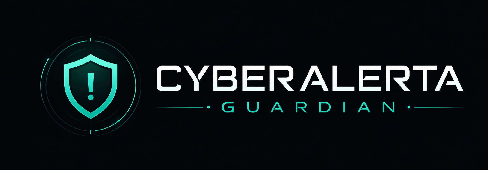

<p align="center">
  
</p>

<h1 align="center">CyberAlerta Guardian</h1>

<p align="center"><b>Analisa mensagens de um WhatsApp autorizado, aponta sinais de golpe e avisa um contato de confiança.</b></p>

<p align="center">
  <a href="https://github.com/GabrielArcanjo777/cyberalerta-guardian/actions/workflows/ci.yml"></a>
</p>

---

## O que é

Um projeto pessoal de estudo. Conecta um número de WhatsApp autorizado por QR code, lê as mensagens recebidas em silêncio e, quando encontra sinais de golpe (Pix suspeito, link falso, falso banco, pedido de código, urgência), registra um caso e manda alerta **apenas para o contato de confiança cadastrado**.

O bot nunca responde ao remetente. Não é produto, não tem usuários, não está publicado em lugar nenhum.

## Como foi feito

Construído com apoio intensivo de IA (LLM) na implementação. O objetivo foi aprender arquitetura, testes, segurança e integração entre plataformas — não lançar software.

Por isso este README lista o que **não** funciona com o mesmo peso do que funciona. Onde eu não sei explicar uma decisão, ela aparece em limitações, não em destaque.

## O que funciona hoje

- `POST /analyze` retorna score de risco e sinais nomeados, por motor de regras determinísticas.
- Painel web (Next.js) com casos, timeline e feedback.
- Login local com Argon2id, MFA/TOTP e RBAC.
- App Android (Kotlin/Compose) que recebe push pelo contato de confiança.
- Casca Windows em Tauri reaproveitando o painel.
- CI no GitHub Actions: `pytest` no backend, `tsc --noEmit` + `eslint` no frontend.

## O que não funciona

- O pipeline com LLM existe e foi testado, mas **não decide nada**. Quem cria caso e notifica é o motor de regras.
- WhatsApp via Evolution API é integração não oficial. Risco real de bloqueio do número.
- Multi-tenant incompleto: `devices` e `notifications` isolam por organização; `Case`, `ProtectedPerson` e `Guardian` não.
- Persistência só em SQLite.
- Rate limit e idempotência ficam em memória — não sobrevivem a restart nem a múltiplos workers.
- Android e Windows com build de debug, sem assinatura.
- Testes e2e (Playwright) quebrados por path no config; fora do CI.
- Sem observabilidade, sem logging estruturado, sem teste com usuários.
- O dataset de 305 mensagens é sintético e gerado por IA. Os números de precisão medidos nele não valem como métrica de mundo real.

## Como rodar

Backend:

```powershell
cd cyberalerta-guardian\backend
python -m venv .venv
.\.venv\Scripts\Activate.ps1
python -m pip install -r requirements.txt
python -m uvicorn main:app --reload --port 8000
```

Interface:

```powershell
cd cyberalerta-guardian\frontend
npm ci
npm run dev
```

- `http://localhost:3000/assisted-demo` — demo guiada, sem dados reais
- `http://localhost:8000/docs` — Swagger

Setup completo em [`docs/LOCAL_SETUP.md`](docs/LOCAL_SETUP.md).

## Testes

```bash
cd backend && python -m pytest app/tests -q
cd frontend && npx tsc --noEmit && npm run lint
cd apps/android-companion && ./gradlew testDevDebugUnitTest
```

## Estrutura

```text
backend/                 FastAPI — API, motor de risco, auth, devices
frontend/                Next.js — painel web e demo assistida
apps/android-companion/  Kotlin/Compose — app do contato de confiança
apps/windows-shell/      Tauri — casca desktop
docs/                    arquitetura, setup, métricas, guia de demo
```

## Aviso

Não é ferramenta de vigilância. Roda apenas em conta própria ou com autorização explícita do titular. Não substitui banco, polícia, advogado ou canal oficial, e não promete detecção infalível — identifica sinais e avisa uma pessoa, que decide.

## Licença

[Elastic License 2.0](./LICENSE).
